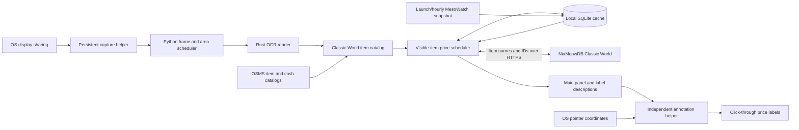

# Lupin architecture

Lupin is a desktop companion for MapleStory Classic World. It recognizes visible items and EXP from OS-shared pixels, looks up meso market references, and draws independent, click-through labels. This document describes the v0.7.0 architecture.

## Boundaries

The application does not discover or inspect game processes, acquire game window handles, read game memory/files/packets, hook rendering or input, send game input, or parent its windows to the game. Window location and item identity come from visible pixels. Ordinary OS pointer coordinates help position labels and prioritize a visible item.

Screenshots and OCR frames remain local. HTTP requests contain catalog/item information, never screenshots. Only Classic World data is accepted. Equipment references assume clean, unscrolled items; NX retail prices remain separate from meso resale references.

## Data flow

## Processes and communication

| Component | Responsibility | Communication |
| --- | --- | --- |
| Main Python/Qt process | Panel, settings, catalog identity, price scheduling and display state | Qt signals, worker results and local IPC |
| Capture helper | Owns the OS-approved screen-sharing session | `QLocalSocket`, bounded frame delivery |
| Rust reader | Detects the game area, shops, tooltips, names, quantities and shop prices | JSON requests/results over its own stdin/stdout; local RGBA frame files |
| Annotation helper | Draws labels and follows the OS cursor | JSON descriptions and pointer reports over its own stdin/stdout |
| Optional headless browser | Reads the public full-market list at launch and hourly, then exits | Dedicated local profile, ephemeral loopback browser endpoint; no game communication |

The local control endpoint also handles this app's second-launch activation, pause/resume, minimization and installer shutdown. It is unrelated to the game.

### Capture and OCR

`price_lens/stream.py` keeps the OS screen-sharing session in a persistent helper. On Wayland, sharing is approved through the desktop portal and delivered by PipeWire. A full-workspace share is cropped locally to the selected display. On Windows, Qt uses the OS screen-capture backend.

`price_lens/capture.py` schedules the Rust reader in `reader/src/main.rs`. The reader uses only Minerva's pinned headless OCR core. Raw RGBA avoids PNG compression on the live path. Backpressure drops obsolete frames, known shop regions reduce work, and pixel fingerprints skip unchanged reads. OCR worker concurrency is limited to two threads.

Automatic game-area detection uses the bottom status bar and visible caption/frame evidence. It does not use the FPS counter as an anchor. Uncertain or ambiguous bounds wait for a manual area; they do not silently enable whole-display item OCR. Lost or stale screen context clears labels and pending visible-item demand.

### Item identity and provider data

`price_lens/domain.py` defines catalog matching, quotes and comparison rules. `price_lens/data.py` loads the OSMS item and cash catalogs and implements the price provider.

Game item IDs differ from NiaMeowDB row IDs. A provider match must agree on both the normalized full name and game ID (`iconKey`). Duplicate names remain unresolved until the provider identifies a single current candidate. Cash items use the same identity checks. OCR similarity never substitutes an arbitrary item or scroll tier.

Provider discovery uses `items?search=...`; prices use `item-market-summary?itemId=...&condition=clean`. The price reference is the 24-hour median when at least five daily reports exist; otherwise the source's longer-window reference is used. Thin data can be displayed with an explicit qualification. These are reported asking/sold prices, not guaranteed completed sales.

## Cache and refresh scheduling

### EXP sessions

`reader/src/experience.rs` uses the pinned core's public status-bar, EXP-bar and minimap-title readers. It shares their recognition model with item OCR. `PixelReader` schedules EXP-only work on its existing process at most once a second; the usual request contains only the bottom 256 pixels of the validated game area. Every five seconds it also checks the minimap title, wherever the minimap was moved. Identical status strips reuse the prior recognition result. EXP-only replies use a separate signal and never replace shop rows or create market demand. Disabling EXP stops these requests; no additional sharing helper or network traffic is introduced.

`price_lens/experience.py` validates level, raw EXP and printed percentage against the interval of totals allowed by rounding. Level changes, large jumps and decreases require another consistent reading. Character changes end the prior run. Rates use observed, unpaused time; standing still counts. Intervals over five seconds without accepted evidence and explicit context/pause boundaries rebaseline without crediting unseen EXP. Percentage-point progress carries 100 points for each level-up; raw EXP spanning a level-up uses the inferred level total and is marked approximate where that total is not unique. No potentially obsolete EXP table is fetched or bundled.

Watching starts automatically after reliable connected character/EXP readings arrive. There is no duration selector. Recent rates use a five-minute rolling average, filling from 30 seconds; the primary display is percentage per minute/hour, with raw EXP and both modes available in Settings. A session timer and gain totals span automatically saved map segments. Reset saves the current segment and begins a new watch; explicit pause excludes a break. Confirmed character changes begin a separate watch. Missing or paused intervals are excluded; standing still counts. Percentage progress carries across level-ups, and inferred raw totals retain an approximation marker.

`experience_widgets.py` builds the persistent page. Optional map labels/notes and history live in dialogs; history rates are per minute. Saved segments remain in a separate per-user SQLite file, capped at 500. Comparisons use the same character/level, at least two minutes and no gaps. Closing saves the current segment. The independent EXP annotation is anchored four logical pixels inside the detected game's bottom-left corner; combined mode adds a third raw-rate line. Its overlay toggle is independent of price labels and EXP reading.

### Manual price search

`price_lens/search.py` searches the cached Classic World catalog locally with a short input debounce. Suggestions never request prices. A selected result adds one manual item or ambiguous name to `PriceService` demand, independent of capture. Manual and screen demand use the same quote/identity keys, worker bounds, TTLs and backoff. Duplicate names are matched to a current provider item before pricing. Leaving Search removes manual demand, cancels queued work and interrupts irrelevant active direct requests. Explicit searches work while automatic screen reading is paused. `price_widgets.py` updates persistent cards in place; a new quote or age does not replace the card or its controls.

`http_json.py` reuses verified HTTPS connections per existing worker thread. It shares a default verifying TLS context, expires connections after 30 idle seconds, bounds hosts per thread, and retries a stale reused connection once after a disconnect. Request timeouts are not automatically repeated. Each worker job has a cancellation token; abandoned direct HTTPS sockets are shut down, waking the worker before the new page is scheduled. Cancellation does not create a retry cooldown or publish an obsolete result. Configured-proxy urllib calls retain their bounded timeout; interruption before their response headers is not guaranteed. Error bodies retain `HTTPError` behavior so coverage rejections remain cached. Configured proxies keep the urllib route. See [Price lookup timing](docs/PRICE_LOOKUP_LATENCY.md).

### Stored data

SQLite entries are keyed by world, record kind and identity. Catalogs and provider-ID/name mappings are cached for one day. Individual price checks default to 15 minutes, with 5/30/60-minute settings. These entries survive restarts, are capped at 6,000 records, and records older than seven days are removed at cache initialization. Separate snapshot tables retain the complete last-good market generation until replaced atomically.

Quote timestamps have different meanings:

- `fetched_at`: when this app successfully checked the source.
- `observed_at`: when the source's latest underlying market report was recorded.
- `published_at`: the whole-market snapshot's publication time, when applicable. Snapshot validity is at most one hour from both publication and check; another check cannot revive an old publication.

A new lookup never changes an old market report's timestamp. Cache expiry, missing/old report times, uncertainty and insufficient samples restrict deal ratings independently. Current comparisons require a matching item, world, clean condition and unit basis. Stars and bullets use per-set pricing.

### Demand and priorities

`price_lens/service.py` owns scheduler state on its Qt thread. HTTP and SQLite provider work runs in a `ThreadPoolExecutor`; workers deliver completions back through an explicitly queued Qt signal.

The UI submits one complete visible view through `observe()`, including the hovered item and ambiguous identities. Before starting requests, the scheduler:

1. Removes queued jobs for items no longer visible. Canceling queued work creates no retry cooldown.
2. Coalesces repeated observations of the same item or identity.
3. Prioritizes a missing/expired hovered item, then other visible missing/expired references, then early background refreshes.
4. Starts at most three simultaneous jobs and retains at most 64 queued jobs. The executor receives only jobs that can start, so a separate FIFO backlog cannot defeat priority changes.

A queued item can be promoted when the cursor moves to it. Already-running requests are allowed to finish and cache their results; they cannot be preempted, so server latency still affects the next available slot. Pausing, losing the reading area or losing fresh screen context cancels queued item work while preserving the approved capture session where supported.

### Expiry and early refresh

The old cached quote is delivered immediately, including after expiry. It keeps its actual age and loses its deal rating when required. Labels distinguish queued refreshes, active refreshes, retry delays, and old market reports; `price_lens/price_status.py` shares these phrases between shop and inventory labels.

Visible, well-supported references with recent market reports may refresh shortly before expiry. Each item's stable staggered lead is between half and all of `min(30 seconds, 5% of the selected TTL)`. A successful refresh starts a new cache cycle. Repeated frames or timer ticks do not cause additional requests within that cycle.

Empty, source-unsupported, uncertain, thin-data and old-report responses keep the full selected TTL. There is no whole-market polling, hidden-inventory scan or background refresh of every cached item. Idle/paused views do not schedule price work.

Normal lookup failures back off for two minutes while retaining the prior quote and timestamps. A failed early refresh can retry at expiry, with at least ten seconds between attempts; a subsequent ordinary failure uses the normal backoff. Ambiguous identity lookups retain their selected cooldown. Known provider coverage rejections become cached no-data results rather than guesses about game tradeability.

## Panel, overlay and controls

`price_lens/ui.py` turns recognized observations and price state into panel cards and annotation descriptions. `price_lens/ui_components.py` renders the cards. The panel's one-second housekeeping tick checks ages and current demand; changed OCR observations can request prices sooner.

`price_lens/overlay.py` manages the independent annotation process in `price_lens/annotations.py`. The annotation helper samples ordinary OS pointer coordinates, repositions existing cards locally, and repaints only affected areas. Cursor movement and animation do not trigger HTTP requests. Linux labels use their own XWayland window for positioning; they are never game child windows.

Shop-row recognition takes priority over generic inventory tooltips inside the shop. Native shop stat popups temporarily hide overlapping row labels. Hover pricing is enabled by default and configurable.

`price_lens/tray.py` provides minimize-to-tray, notification and menu behavior. Hotkeys use Windows `RegisterHotKey`, the Wayland GlobalShortcuts portal, or an X11 passive grab for the selected chord. There are no keyboard listeners or input hooks.

## Packaging and updates

`scripts/package_common.py` stages application code, public fixtures, documentation and dependency notices. Linux and Windows staging scripts add pinned, SHA-256-verified runtimes and the appropriate OCR executable. Generated packages exclude private evidence, live screenshots, settings and SQLite databases.

- Windows: per-user Inno Setup installer and portable ZIP.
- Linux: pacman package for Arch/Manjaro and a DEB for Debian/Ubuntu.
- Shared: bundled Python, Qt, OCR reader, approved icon, offline self-test and checksums.

Installed application directories stay read-only during normal use. Settings, caches and bounded capture diagnostics use per-user locations. Linux UI handoff can preserve the existing capture helper; normal Quit ends sharing. No system-wide Qt configuration is changed.

Build commands and prerequisites are in [packaging/README.md](packaging/README.md). Native Windows capture, mixed-DPI alignment and physical shortcut acceptance remain separate from Wine binary/installer tests; macOS is not a validated distribution target.

`scripts/publish_itch.py` validates the released artifact checksums and every portable build file before uploading through the official Butler CLI. It uses stable platform channels and the application version, checks the anonymous project's password gate before and after publishing, and never changes the shared password or visibility. Butler owns local authorization outside the repository. Native installer/package channels include extraction instructions because Butler's browser downloads are ZIPs. Publisher-only tests live under `scripts/tests` and are separate from the application's packaged test suite.

## Verification and extension points

The tests combine real upstream OCR fixtures and local IPC with isolated UI, clock and network fixtures. Scheduling tests block controlled workers to prove priority, queue bounds, visibility cancellation, thread ownership, stale-reference delivery, retry behavior and request counts across repeated observations. They never drive a game or start OS sharing.

When adding a provider, preserve world/item/condition/unit validation and both timestamps. When changing scheduling, retain per-item deduplication, bounded concurrency, the full TTL for no-data results and immediate cancellation of obsolete queued demand. Changes to OCR or capture must preserve the screen-only boundary and the existing sharing workflow.

See [VERIFICATION.md](VERIFICATION.md) for measured coverage and platform limits, and [docs/TECHNICAL.md](docs/TECHNICAL.md) for runtime details.

## Lupin naming compatibility

Lupin is the public app, menu, tray and release name. The Python module, internal package-manager identity, installation directories, Qt application/settings identity, capture/control sockets, desktop-file ID and Windows AppId retain their existing Classic Price Lens identifiers. This preserves upgrades, hotkeys, sharing, price caches and EXP history. Linux also supplies a `lupin` launcher; download filenames use Lupin/lupin. Windows upgrades remove only the old app-owned shortcut names and create Lupin shortcuts. The public repository/project name and new URLs are `zhuffman68/lupin`; platform redirects preserve earlier links. Private GitHub visibility and the itch.io password gate are verified independently of the source build.

The EXP page uses `experience_widgets.py` for its visual hierarchy and separate history/options dialogs; `experience_ui.py` retains session behavior. Optional details are collapsed, and session buttons change with recording state.

## Stable layout, motion and shop priority in v0.7.0

The brand and display/status controls sit above a fixed tab bar. Initial setup instructions, the first-use success message and shop counts are inside Prices, so they cannot move navigation. All tabs retain the selected display. Automatic detection distinguishes a recognised Classic World area from a manually selected area.

`motion.py` supplies interruptible tab snapshots, short section transitions and text reveals. Reduce motion removes transitions and pauses the header sprite. `branding.py` plays an unchanged three-frame local Lupin WebP and renders a font-outline SVG wordmark; hidden/minimised headers stop playback. Body text retains a normal readable font. No runtime asset downloads are needed.

While any shop is open, inventory tooltip pricing is suppressed. Native shop tooltips no longer hide all listing labels. `shop_rows.py` can retain a covered row only while the independently captured shop header and scrollbar fingerprints remain identical. A visible listing change, movement or changed guard discards that page's memory. After three seconds of occlusion the listing amount is withdrawn and no deal rating is shown, while a verified market reference can remain. If the list itself is unreadable, matching header/scrollbar pixels can still establish an open shop.

A cropped read that still finds names but loses prices is immediately retried on the full captured area. This handles a shop moved partly outside the prior crop. A genuinely incomplete full read disables the crop until clean listings return. New item work can precede the periodic EXP read; the usual one-second EXP cadence can defer by roughly 0.6 seconds while item pixels change.

## Provider identity index

A low-priority, once-daily job reads MesoWatch's published JSON ID assignment without evaluating JavaScript. Its 1,608-entry sample agreed with 153 existing verified mappings and disagreed with none of the covered entries. It never establishes a new identity. A mapping must first be checked against the provider's exact full name and game ID. If its saved proof, name, provider ID and a fresh index fingerprint agree, it can be reused for up to seven days. An index version change or missing/mismatched entry falls back to source validation. Adding index proof preserves the original provider-check timestamp. The index is independent of price freshness, report ages, the selected quote TTL and coverage/error caching. Its background request can yield to visible price work.

### Whole-market cache

`snapshot.py` validates the live MesoWatch v2 Classic World list, exact IDs/names, units, publication time and each row's market sample count (`priceSales`, never lifetime `sold`). Prices are meso values, including cash items; NX retail fields are ignored. A complete generation replaces separate local SQLite snapshot tables atomically. A failed, invalid or older generation preserves the previous copy and its ages. The cache is never included in source or release assets.

`SnapshotStore.quote()` checks the catalog ID, full name and per-item/set basis before exposing a reference. The scheduler uses valid snapshot prices immediately without item requests. Unpriced/missing/mismatched entries use the ordinary fallback cache and provider. A fresh snapshot can also resolve duplicate catalog names only when exactly one candidate's ID/full name is present. Unknown/low-volume/scrolled-only data remain neutral. Check time, publication time and latest sale time are separate. A new download never makes an old publication fresh.

`snapshot_updater.py` refreshes asynchronously on every launch/enable, even when saved data is recent, then at most an hour after success, slightly earlier when needed to avoid expiry of an already-aged publication. Already-old publications still wait an hour rather than repeatedly opening a browser. Simultaneous triggers coalesce. Failures retry after 5/15/60 minutes; disabling stops the timer and the owned browser while leaving saved data.

`snapshot_browser.py` reuses an installed Edge/Chrome/Chromium (or an existing compatible Playwright browser) in headless mode, with a dedicated app-cache profile. It uses an ephemeral loopback browser endpoint to read the public page's loaded list, then closes that browser. It does not discover/use the user's personal browser session, solve challenges, download a browser, add a resident service, or communicate with a game. Each attempt is capped at 25 seconds. Chrome/Edge/Chromium is optional: individual fallback pricing remains available without it.
