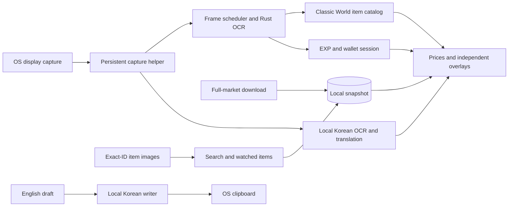

# Lupin architecture

Lupin v0.14.0 provides market references, EXP/meso tracking and local Korean translation for MapleStory Classic World.

## Observation boundary

Game observations come only from ordinary OS-shared screen pixels. No game-process discovery, handles, memory, files, packets, rendering/input hooks or game input are used. The annotation canvas is an independent input-transparent window. OS cursor coordinates position inventory cards. Windows shortcuts use RegisterHotKey; Wayland uses the GlobalShortcuts portal and X11 uses passive grabs for the chosen chords.

Screenshots, chat and drafts remain local. Market downloads contain public market data; image downloads use exact catalog IDs. The Korean writer copies validated text to the OS clipboard only after an explicit action. It never pastes, sends keys or focuses a game field.

## Processes and data flow

The main Qt process owns settings, layouts, market state and session accounting. Capture and annotations use separate helpers. The Rust reader accepts only local RGBA/PNG input through its own JSON stdin/stdout. Translation workers communicate over bounded local pipes and load their verified models on demand. All portal callbacks enter the Qt GUI thread through signals.

## Capture and recognition

Linux retains its approved PipeWire/portal sharing session. SIGUSR1 hands the capture helper to a replacement UI without another chooser. Normal Quit ends sharing. The explicit KDE screenshot fallback remains available for troubleshooting.

Windows captures the selected OS display with `QScreen.grabWindow(0)`, using desktop GDI rather than Direct3D desktop duplication. It never obtains a game window handle. The dropdown contains real displays; geometry changes update the selected display. Capture runs at most ten times per second, pauses without demand, and skips work while its local output is busy.

Frame dimensions and local buffers are bounded. The client drains packets promptly and retains one newest completed frame; the display interval applies to delivery, not socket reads. Superseded frames are discarded. Pause, stop and display changes clear pending delivery.

The visible bottom status bar and static frame evidence locate Classic World. FPS and movable minimap placement are not anchors. Shop/tooltip pixel fingerprints avoid repeated OCR and preserve proven identities through modest movement and occlusion. Equipment names include gender/stat/tier evidence; ambiguous IDs remain unresolved.

Only a missing, uncovered shop price triggers a retry. A cropped shop passes through the unchanged strict upstream reader at two resamplings. Recovery requires agreement on exact name, row position, quantity and the complete meso amount. Existing prices are never overwritten. An eight-patch pixel cache also remembers failures. The pinned Minerva revision and OCR model are unchanged; the worker uses two OCR threads.

## One full-market cache

`PriceService` loads the Classic World regular/cash catalog and manages a single `SnapshotStore`/`SnapshotUpdater`. There is no individual-price provider, per-item HTTP queue or provider-ID index.

On every launch, saved data loads immediately and one asynchronous full-market download starts. Later downloads follow the selected 5/15/30/60-minute interval. Changing the interval reschedules from the last successful check. Overlapping refreshes coalesce. Overlay, search and watched-item prices are local snapshot reads; typing, selecting, hovering and watching never initiate individual price requests.

A short-lived native `lupin-market-fetch` helper reads the ordinary public market page using system web views: WebKitGTK on Linux and the shared production WebView2 runtime on Windows. It uses an offscreen/invisible window owned by the helper, never a game window. Linux uses an ephemeral context; Windows uses an app-owned data directory and disables OS-account single sign-on. Website permission requests and new windows are denied. No personal browser, installed browser discovery, DevTools socket or resident service is involved. Well-formed source rows with different listing/catalog IDs are excluded as unverified aliases; they never map prices to either ID. Malformed identities, duplicates, wrong worlds and empty exact generations still reject the update.

`SnapshotFetcher` bounds UTF-8 stdout to 8 MiB, retains only bounded diagnostic stderr, accepts one JSON object after a successful helper exit and enforces a deadline. Stop/cancellation discards pending results; refreshes coalesce while a previous helper shuts down. Only the subprocess created by Lupin is terminated. The Windows helper's private job controls its own descendants so cancellation cannot leave its renderer running. Full generation validation still occurs in `SnapshotStore` before replacement.

A complete generation is validated before an atomic SQLite replacement. Checks require Classic World, live list schema, exact IDs/names, clean equipment and item/set units. Failed/invalid refreshes retain the last-good data and its original ages. A transient startup failure gets one retry after 15 seconds, then uses bounded 5/15/60-minute backoff. Missing runtimes and invalid documents do not trigger the startup retry. Successful refreshes never inherit a failure cooldown. `market-last-error.json` retains only the failure kind, exit code, time and up to twelve fixed helper stage/error-code pairs, never page bodies or user text. Connection details shows the current process's retained failure.

Check time, publication time and latest observed-sale time are distinct. Validity ends at the earlier of check time plus the selected interval and publication time plus one hour. Old/missing observations, thin samples and uncertain units cannot earn deal colors. Rechecking an unchanged publication cannot make its publication or observed sales newer. Missing items stay unpriced.

The larger item panel shows the source's latest observed-sale time. The full list does not supply a verified individual transaction amount; the market median is never presented as the latest sale price.

## Prices and watched items

The locator can retain a proven footer span while an item description covers its white rim, provided the independent LV template and OS caption still verify the same coordinates. Losing those anchors still removes the game area. Shop selection/unreadable names can retain references under verified page guards, without an assumed listing amount. A listing returns without another OCR pass only when the entire previously read row pixels and page guards match exactly. Occlusion alpha uses the recognized current description rectangle only; late OCR replies cannot restore a description absent from the latest frame. The old covered-row opacity fallback is removed.

Clicked item-link descriptions may be located beyond the pointer's usual search area. The Rust reader reuses its existing name/bullet recognizer over bounded analysis regions without changing the real cursor or sending input. The GUI requires a catalog match and a visible anchored native description panel before accepting those results. Such cards remain beside the description. Small-font I/l and g/q variants and ellipsis punctuation are accepted only for unique catalog candidates; shorter shared Ink-and-Wash prefixes remain ambiguous.

Search is part of Prices and takes space priority while active. Clearing it animates shop cards back into view. Shop cards retain their widget instances and layout positions during quote/age updates. Adding a hovered item does not change shop-card identities. Search, shop and inventory cards share an exact-ID watch star and thumbnails. The removed Details expander has no runtime path.

Watched items start collapsed. Expanding shows a compact list with thumbnails and cached references, capped at three visible rows. Its contents stay at a stable full height while a clipping viewport slides, avoiding repeated list reflow. Header/empty-space clicks toggle the panel; items, stars and the scrollbar retain their actions. Rounded selection covers the full row.

Only an item click opens its larger card and takes space priority. Expanding alone retains the normal item/ready view. Deselecting clears that card while retaining the watched view. Collapsing clears the selection and returns to shop cards. Watching/unwatching changes saved exact IDs, not market demand. In-game watched labels shimmer twice inside a steady border and retain a star. Reduced motion uses a steady marker.

Thumbnail downloads share a two-request queue, bounded memory/disk caches and negative caching. Cached images are used immediately without waiting for a network signal. No fetched thumbnails ship.

## Tracking and translation

EXP/wallet tracking always starts stopped. Explicit Start enables its reader. Rates use 30 seconds of valid observations; pause/context loss excludes unseen changes. Percent is the default EXP unit; raw/both are available. Meso tracking records net wallet change, including purchases, sales and trades, without estimating carried-potion costs or unsold loot. History/CSV stay local. The optional bottom-left tracker appears only for running/paused tracking.

The Korean reader scans the detected full game area for a short configurable window, independent of cursor proximity. New scans supersede old work. Matching source pixels retain cards through modest movement; linger and no-result timers are bounded. The Korean original is retained and unstated price/percentage units are not invented.

The writer uses conservative trade/party shorthand and numeric validation before explicit Translate & Copy. Editing/canceling invalidates pending copies. Both verified int8 model bundles remain included. See [Korean notes](docs/KOREAN_CHAT.md).

## Presentation, persistence and packaging

Inter is bundled for consistent interface/price typography. The GUI uses a small coin for currency words, except MESO on the tracking panel and EXP/Meso Tracking on its tab; game-overlay text remains plain. Tracking unit coins appear only alongside available numbers. Digit-place animation keeps surrounding text/columns steady. Page slides and section transitions are interruptible and respect Reduce motion.

Maximization and control-panel pinning are disabled. Fresh default geometry is 509 × 829, bounded to the display, with a 460-pixel minimum width. Normal user sizes persist; desktop-sized/maximized geometry cannot replace a compact preference. Long item/history lists can scroll independently. Main and translation tab labels are underlined.

Programs install to `/opt/lupin` or `%LOCALAPPDATA%\\Programs\\Lupin`; launchers/readers use Lupin names. Windows upgrades move the old program directory, preserve additional files, remove obsolete shipped modules and support rollback before commit. Shutdown sends Quit through Lupin's own local pipe and waits for that specific server process to finish unloading; synchronization-only access comes from the pipe's server PID, with no process enumeration or termination. Stable settings/socket/portal IDs preserve data and approved sharing. The WebView2 SDK, loader and official setup bootstrapper have pinned download hashes. Windows setup checks/prepares the shared runtime before closing an existing installation; Linux package dependencies provide WebKitGTK. The browser engine is not bundled. Both runtime/model manifests are pinned; install roots stay read-only in normal use. Private evidence, credentials, screenshots and caches are excluded. See [packaging](packaging/README.md) and [verification](VERIFICATION.md).

The Windows Korean writer registers the existing PySide6 DLL directory before loading CTranslate2, retaining its directory handle for the worker lifetime. This reuses the bundled Microsoft C++ runtime without importing Qt or requiring a system Visual C++ installation. Cold writer startup has a 60-second deadline; individual inference requests retain their 12-second deadline.
