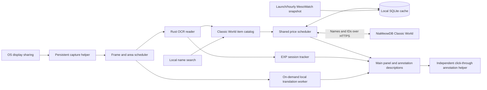

# Lupin architecture

Lupin provides market prices, EXP tracking and local Korean speech-bubble translation for MapleStory Classic World. This document describes v0.9.0.

## Boundaries

All game observations come from OS-shared screen pixels. The application never discovers or inspects game processes, acquires game window handles, reads game memory/files/packets, hooks rendering or input, sends game input, or parents its windows to the game. Ordinary OS pointer coordinates position labels and prioritize nearby items/messages. Global shortcuts use only OS registration: Windows RegisterHotKey, Wayland GlobalShortcuts, or an X11 passive grab for the chosen chord.

Screenshots and chat remain local. Market HTTP requests contain catalog/item information, never screenshots. Only Classic World data is accepted. Equipment references assume unscrolled items; NX retail costs never substitute for meso resale references.

## Components and data flow

| Component | Responsibility | Communication |
| --- | --- | --- |
| Main Python/Qt process | Panel, feature state, settings, scheduling and price cache | Qt signals, worker completions and local IPC |
| Capture helper | Owns the OS-approved sharing session | QLocalSocket with bounded frame delivery |
| Rust reader | Game-area, shop, tooltip and EXP recognition | JSON over its own stdin/stdout; local raw RGBA files |
| Annotation helper | Independent labels and OS-cursor following | JSON descriptions and pointer reports over stdin/stdout |
| Translation worker | Bubble detection, Korean OCR, glossary and local translation | Bounded in-memory frame pipe; no network or screenshot files |
| Optional headless browser | Reads the public full-market list, then exits | Dedicated profile and ephemeral loopback browser endpoint |

`control.py` handles this app's second-launch activation, reader pause/resume, feature actions, minimization and installer shutdown. It has no game connection.

## Capture and OCR

`stream.py` retains the approved sharing session. Wayland capture uses the desktop ScreenCast portal and PipeWire. The app has one display dropdown; OS sharing consent remains a separate required dialog. A full-workspace share is cropped locally to that display. Windows uses Qt's OS capture backend.

`capture.py` schedules `reader/src/main.rs`, which uses the pinned Minerva headless core. Raw RGBA avoids live PNG compression. Bounded frame delivery, dropped obsolete frames, local shop regions and unchanged-pixel fingerprints reduce work. Fingerprints refer to the submitted frame even when a newer capture arrives during recognition. The complete known shop span remains the crop reference when a native tooltip hides some rows, so those rows can recover after it closes. The worker uses at most two OCR threads.

Automatic location uses visible caption/frame evidence and the bottom status bar, without the FPS counter. Static bottom-bar guards tolerate focus-color changes; the caption fast path compares static edges rather than requiring one active-title color. Known shop crops avoid resending the full display between periodic location checks. Ambiguous game bounds wait for a manual area. Lost/stale context clears labels and visible price demand immediately; a short badge hysteresis avoids status flicker without retaining labels at uncertain coordinates.

F10 disables price OCR/labels and their visible demand while retaining capture, game location and any explicitly running EXP session. A locator-only request maintains game position when prices are disabled. Pause reading suspends the shared reader; Resume reuses sharing. Linux UI upgrades can hand off the existing capture helper through the app's own SIGUSR1 handler. Normal Quit ends sharing.

## Item identity and market references

`domain.py` defines catalogs, quotes and comparison rules. `data.py` loads OSMS item/cash catalogs and the fallback provider. Provider database row IDs differ from game item IDs: both the full normalized name and game ID (`iconKey`) must match. Ambiguous variants remain unresolved until current provider data establish a single identity. OCR similarity never substitutes a random item or scroll tier.

Fallback discovery uses `items?search=...`; pricing uses `item-market-summary?itemId=...&condition=clean`. The 24-hour median is used with at least five daily reports; otherwise the longer-window reference can be shown with qualification. Reported prices do not guarantee completed sales. Stars and bullets use per-set units.

A once-daily public MesoWatch ID index can extend an already verified mapping only when its saved proof, exact name, provider ID and fresh index fingerprint agree. It never establishes an unverified identity. Mismatches fall back to source validation. Identity freshness is separate from price and report freshness.

### Whole-market cache

`snapshot.py` validates the MesoWatch v2 Classic World list: exact IDs/names, units, publication time and per-row `priceSales` count, never lifetime `sold`. Cash values are mesos; NX retail fields are ignored. Complete generations atomically replace separate SQLite snapshot tables. Invalid, failed or older updates preserve the last-good copy and its real ages. Price caches are never shipped.

`SnapshotStore.quote()` checks catalog identity and per-item/set basis before exposing a price. Valid snapshot entries bypass per-item requests. Unpriced, missing or mismatched entries use the normal fallback scheduler. Duplicate names resolve only when exactly one candidate ID/full name is supported. Thin, old or uncertain data remain neutral.

`snapshot_updater.py` refreshes asynchronously on launch/enable, then hourly, slightly earlier if needed for an already-aged publication. An old publication still waits an hour instead of repeatedly opening browsers. Triggers coalesce; failures retry after 5/15/60 minutes. Disabling stops the timer and owned browser, preserving saved data. `snapshot_browser.py` uses an installed Edge/Chrome/Chromium or compatible existing Playwright browser, an app-owned profile and a 25-second attempt cap. It never uses the personal browser profile, downloads a browser, solves challenges, adds a resident service or accesses a game.

### Per-item cache and scheduling

SQLite entries are keyed by world, record kind and identity. Catalog/provider mappings last one day. Individual prices default to 15 minutes, with 5/30/60-minute choices. Records survive restarts, are capped at 6,000 and are pruned after seven days. Snapshot generations are separate and retained until replaced.

`fetched_at` means a successful source check; `observed_at` is the latest market report; `published_at` is a snapshot publication. Snapshot validity is capped at one hour from both publication and check. A new check cannot revive an old report or publication. Expiry, missing report time, uncertainty and low sample counts independently restrict deal ratings.

`service.py` owns state on the Qt thread and bounds workers to three active/64 queued jobs. Each observation replaces the complete visible demand. Jobs coalesce; obsolete queued work is removed. Manual selection and hovered missing/expired items precede other visible prices, followed by early refreshes. Cached values are delivered immediately, including expired values with their actual ages and no unsupported deal rating.

Well-supported visible references can refresh before expiry using a stable staggered lead of half to all of `min(30 seconds, 5% of TTL)`. Empty, unsupported, uncertain, thin and old-report results retain the full TTL. Failures back off for two minutes; an early failure may retry at expiry with a ten-second minimum gap. Stationary frames never create repeated requests within a cache cycle. The hourly full-market job is separate; there is no hidden-inventory scan or per-item refresh of every saved record.

`http_json.py` reuses verifying TLS connections per worker with a 30-second idle limit. A stale disconnected connection retries once; timeouts are not automatically repeated. Cancelled direct requests close their sockets and cannot publish obsolete results or create cooldowns. Configured proxies retain the bounded urllib path; cancellation before response headers is not guaranteed. Coverage rejections become cached no-data results. See [price lookup timing](docs/PRICE_LOOKUP_LATENCY.md).

## Panel and overlays

The brand, display/status controls, Pause/Resume and Hotkeys remain above three fixed tabs: Prices, EXP Tracking and Translation. `search.py` searches the local catalog with a short debounce; typing/suggestions never request prices. Selecting an item adds one manual demand to the shared scheduler. Clearing it removes demand and retires results. Search has layout priority over collapsible on-screen results and works without capture. `price_widgets.py` updates cards in place.

`motion.py` implements interruptible horizontal page slides, brief section transitions and rolling EXP digits. Reduce motion removes animations and pauses the header. `branding.py` plays complete local original-game walk/attack GIFs at native delay values and outlines a local Pixelify Sans wordmark. Hidden/minimized headers stop playback. The approved Lupin skill icon is local and exported with nearest-neighbor scaling.

`overlay.py` owns `annotations.py` in an independent click-through window. Cursor-following cards repaint locally without OCR or HTTP work. Shops always suppress generic inventory price cards. `shop_rows.py` stabilizes small geometry noise and retains known identities across verified occlusion. Changed visible listings or unoccluded guards invalidate hidden-page data; old covered listing amounts lose their deal rating.

`tooltip_geometry.py` measures a native description panel only around an OCR-recognized tooltip name. Overlapping shop labels stay in place and fade to 15% opacity; unaffected labels stay opaque. A hidden row can retain its known market reference only while unaffected page guards agree, without assuming a current listing/deal. Labels recover when the panel disappears. Translation and EXP overlays are unaffected by this opacity rule.

## EXP tracking

`reader/src/experience.rs` uses Minerva's status-bar, EXP-bar and minimap-title readers, sharing the existing model/process. Sampling is at most once a second, usually the bottom 256 pixels of the verified game area. A map-title read runs every five seconds, wherever the minimap was moved. Unchanged strips reuse recognition. EXP replies never replace shop rows or create market requests; changing item pixels can briefly defer sampling.

`experience.py` validates level/raw EXP/printed percentage against rounding intervals. Large jumps, level changes and decreases need consistent confirmation. Character changes segment the run. Missing intervals over five seconds rebaseline instead of crediting unseen gain. Explicit pauses exclude breaks; standing still counts. Percentage points carry across level-ups. Raw gain across levels uses inferred totals and retains approximation markers; no obsolete EXP table is fetched.

Every launch begins stopped. Start or F11 explicitly enables sampling; F11 then pauses/resumes. Stop saves and disables sampling. Gain/time are available immediately; rates and ETA require 30 valid tracked seconds and use a five-minute window. A paused session keeps its pace snapshot. Percentage is default, with raw and both modes. The optional overlay sits four logical pixels inside the game's bottom-left and exists only for a started, fresh running/paused session. Its page and Settings toggles share one value.

History/options are separate dialogs. Map segments save automatically; a session timer spans them. A separate local SQLite file stores at most 500 segments and supports CSV export. Comparisons use the same character/level, at least two minutes and no gaps. Closing saves the current segment but never restores automatic tracking next launch.

## Local Korean translation

`chat.py` owns a demand-driven local QProcess. F12 (F9 Windows) enables/preloads it if needed and requests a fresh game-cropped shared frame. `chat_ocr.py` detects neutral speech bubbles and recognizes lines using CPU-only Korean PP-OCRv5 mobile. `chat_text.py` provides conservative phrase glosses and explicit numeric-unit checks; ordinary uncovered text uses int8 OPUS-MT. Bare numbers never receive an assumed multiplier or currency. Unknown jamo/slang stay original or partial rather than invented English.

One no-result scan can retry a fresh frame after 120 ms with slightly wider bubble-color tolerance. There is no continuous chat OCR. One in-flight request, two passive compute threads, a 1.5-second between-bubble budget and bounded in-memory text/crop caches constrain resources. Disabling unloads the worker/models. Startup and price scheduling are independent. Translation never uploads/stores chat or screenshots.

Cards prioritize English, retain the original/speaker and mark uncertainty only when relevant. They expire after eight seconds or when source pixels move/change. Recent results remain on the Translation page. Moving bubbles, expanded chat history, dark bubbles and arbitrary desktop Korean are not supported. [Model/license/performance details](docs/KOREAN_CHAT.md).

## Distribution and compatibility

Windows provides a per-user Inno Setup installer and portable ZIP. Linux provides `lupin` pacman/DEB packages replacing `classic-price-lens`. Bundled Python/Qt/readers/models have pinned inputs and notices. Install trees stay read-only in normal use; settings, history, caches and bounded diagnostics use per-user paths. Linux package metadata changes, while legacy module/install/settings/socket/desktop/portal identifiers and Windows AppId stay stable for migration. The new icon resource name refreshes old app-owned launchers without replacing the desktop identity.

`scripts/publish_itch.py` verifies artifacts/portable manifests, uploads five stable Butler channels and checks the existing anonymous password gate before/after. Authorization stays outside source. GitHub remains private. [Build prerequisites](packaging/README.md) and [validation evidence](VERIFICATION.md) distinguish source/fixture/installer checks from physical Windows capture. macOS is not a validated release target.
