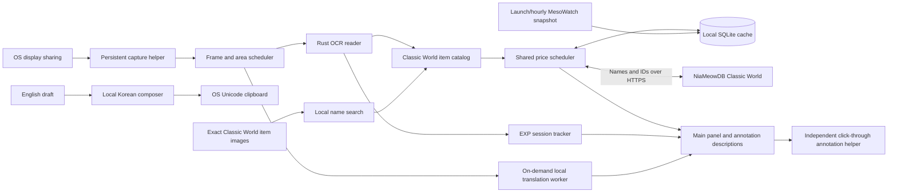

# Lupin architecture

Lupin provides market prices, EXP/meso tracking and local Korean translation in both directions for MapleStory Classic World. This document describes v0.12.0.

## Boundaries

All game observations come from OS-shared screen pixels. The application never discovers or inspects game processes, acquires game window handles, reads game memory/files/packets, hooks rendering or input, sends game input, or parents its windows to the game. Ordinary OS pointer coordinates position price labels; translation does not depend on cursor proximity. Global shortcuts use only OS registration: Windows RegisterHotKey, Wayland GlobalShortcuts, or an X11 passive grab for the chosen chord.

Screenshots and chat remain local. Market HTTP requests contain catalog/item information, never screenshots. Only Classic World data is accepted. Equipment references assume unscrolled items; NX retail costs never substitute for meso resale references.

## Components and data flow

| Component | Responsibility | Communication |
| --- | --- | --- |
| Main Python/Qt process | Panel, feature state, settings, scheduling and price cache | Qt signals, worker completions and local IPC |
| Capture helper | Owns the OS-approved sharing session | QLocalSocket with bounded frame delivery |
| Rust reader | Game-area, shop, tooltip and EXP recognition | JSON over its own stdin/stdout; local raw RGBA files |
| Annotation helper | Independent labels and OS-cursor following | JSON descriptions and pointer reports over stdin/stdout |
| Translation worker | Bubble detection, Korean OCR, glossary and local translation | Bounded in-memory frame pipe; no network or screenshot files |
| Composer worker | Demand-driven English-to-Korean inference | UTF-8 JSON over its own pipes; no game input or network |
| Optional headless browser | Reads the public full-market list, then exits | Dedicated profile and ephemeral loopback browser endpoint |

`control.py` handles this app's second-launch activation, reader pause/resume, feature actions, minimization and installer shutdown. It has no game connection.

## Capture and OCR

`stream.py` retains the approved sharing session. Wayland capture uses the desktop ScreenCast portal and PipeWire. The app has one display dropdown; OS sharing consent remains a separate required dialog. A full-workspace share is cropped locally to that display. Windows uses Qt's OS capture backend.

`capture.py` schedules `reader/src/main.rs`, which uses the pinned Minerva headless core. Raw RGBA avoids live PNG compression. Bounded frame delivery, dropped obsolete frames, local shop regions and unchanged-pixel fingerprints reduce work. Fingerprints refer to the submitted frame even when a newer capture arrives during recognition. The complete known shop span remains the crop reference when a native tooltip hides some rows, so those rows can recover after it closes. The worker uses at most two OCR threads.

Automatic location uses visible caption/frame evidence and the bottom status bar, without the FPS counter. Static bottom-bar guards tolerate focus-color changes; the caption fast path compares static edges rather than requiring one active-title color. Known shop crops avoid resending the full display between periodic location checks. Ambiguous game bounds wait for a manual area. Lost/stale context clears labels and visible price demand immediately; a short badge hysteresis avoids status flicker without retaining labels at uncertain coordinates.

Super/Win+F9 disables price OCR/labels and their visible demand while retaining capture, game location and any explicitly running EXP session. A locator-only request maintains game position when prices are disabled. Pause reading suspends the shared reader; Resume reuses sharing. Linux UI upgrades can hand off the existing capture helper through the app's own SIGUSR1 handler. Normal Quit ends sharing.

## Item identity and market references

`domain.py` defines catalogs, quotes and comparison rules. `data.py` loads OSMS item/cash catalogs and the fallback provider. Provider database row IDs differ from game item IDs: both the full normalized name and game ID (`iconKey`) must match. Ambiguous variants remain unresolved until current provider data establish a single identity. OCR corrections use unique catalog matches and a small whole-word alias list for letter-shape errors such as Soroll/Scroll, Arrnor/Armor and Mushroorn/Mushroom. Hyphens/nametag spacing and visible ellipses normalize for reading/search only. Stats, tier values and price numbers are never guessed; provider identity still requires the exact canonical name and ID. Displayed meso amounts round to whole numbers, with source precision retained for comparisons.

Fallback discovery uses `items?search=...`; pricing uses `item-market-summary?itemId=...&condition=clean`. The 24-hour median is used with at least five daily reports; otherwise the longer-window reference can be shown with qualification. Reported prices do not guarantee completed sales. Stars and bullets use per-set units.

A once-daily public MesoWatch ID index can extend an already verified mapping only when its saved proof, exact name, provider ID and fresh index fingerprint agree. It never establishes an unverified identity. Mismatches fall back to source validation. Identity freshness is separate from price and report freshness.

### Whole-market cache

`snapshot.py` validates the MesoWatch v2 Classic World list: exact IDs/names, units, publication time and per-row `priceSales` count, never lifetime `sold`. Cash values are mesos; NX retail fields are ignored. Complete generations atomically replace separate SQLite snapshot tables. Invalid, failed or older updates preserve the last-good copy and its real ages. Price caches are never shipped.

`SnapshotStore.quote()` checks catalog identity and per-item/set basis before exposing a price. Valid snapshot entries bypass per-item requests. Unpriced, missing or mismatched entries use the normal fallback scheduler. Duplicate names resolve only when exactly one candidate ID/full name is supported. Thin, old or uncertain data remain neutral.

`snapshot_updater.py` refreshes asynchronously on launch/enable, then hourly, slightly earlier if needed for an already-aged publication. An old publication still waits an hour instead of repeatedly opening browsers. Triggers coalesce; failures retry after 5/15/60 minutes. Disabling stops the timer and owned browser, preserving saved data. `snapshot_browser.py` uses an installed Edge/Chrome/Chromium or compatible existing Playwright browser, an app-owned profile and a 25-second attempt cap. It never uses the personal browser profile, downloads a browser, solves challenges, adds a resident service or accesses a game.

### Per-item cache and scheduling

SQLite entries are keyed by world, record kind and identity. Catalog/provider mappings last one day. Individual prices default to 15 minutes, with 5/30/60-minute choices. Records survive restarts, are capped at 6,000 and are pruned after seven days. Snapshot generations are separate and retained until replaced.

`fetched_at` means a successful source check; `observed_at` is the latest market report; `published_at` is a snapshot publication. Snapshot validity is capped at one hour from both publication and check. A new check cannot revive an old report or publication. Expiry, missing report time, uncertainty and low sample counts independently restrict deal ratings.

`service.py` owns state on the Qt thread and bounds workers to three active/64 queued jobs. Each observation replaces the complete visible demand. Jobs coalesce; obsolete queued work is removed. Manual selection and hovered missing/expired items precede other visible prices, followed by early refreshes. Cached values are delivered immediately, including expired values with their actual ages and no unsupported deal rating.

Well-supported visible references can refresh before expiry using a stable staggered lead of half to all of `min(30 seconds, 5% of TTL)`. Empty, unsupported, uncertain, thin and old-report results retain the full TTL. Failures back off for two minutes; an early failure may retry at expiry with a ten-second minimum gap. Stationary frames never create repeated requests within a cache cycle. The hourly full-market job is separate; there is no hidden-inventory scan or per-item refresh of every saved record.

`http_json.py` reuses verifying TLS connections per worker with a 30-second idle limit. A stale disconnected connection retries once; timeouts are not automatically repeated. Cancelled direct requests close their sockets and cannot publish obsolete results or create cooldowns. Configured proxies retain the bounded urllib path; cancellation before response headers is not guaranteed. Coverage rejections become cached no-data results. See [price lookup timing](docs/PRICE_LOOKUP_LATENCY.md).

## Panel and overlays

The brand, display/status controls, Pause/Resume and Hotkeys remain above three fixed tabs: Prices, EXP/Meso Tracking and Translation. `search.py` searches the local catalog with a short debounce; typing/suggestions never request prices. Selecting an item adds one manual demand to the shared scheduler. Clearing it removes demand and retires results. Search has layout priority over collapsible on-screen results and works without capture. `price_widgets.py` updates cards in place.

`thumbnails.py` supplies exact Classic World images from OSMS Data Explorer by game item ID, independently of price requests. Only visible search rows and the selected card create image demand. Two downloads run at once, at most 16 currently wanted IDs are queued, and obsolete queued work is dropped. PNG responses are bounded by bytes/dimensions before decode. Images have a 30-day disk TTL; misses wait six hours. Disk/memory limits are 512/96 images. A missing or ambiguous image leaves a placeholder without blocking prices. The source is the Classic World item-image route, never a guessed original-GMS image.

`motion.py` implements interruptible horizontal page slides, brief section transitions and rolling numerical values shared by widgets and overlay cards. Reduce motion removes animations and pauses the header. `branding.py` plays complete local original-game walk/attack GIFs at native delay values and outlines a local Pixelify Sans wordmark. Hidden/minimized headers stop playback. The approved 32px Lupin artwork is unchanged. Native PNG sizes include 20/22/28/40/56px for small and fractional-DPI surfaces; noninteger sizes are filtered once from the master and integer enlargements retain native pixels. A scalable pixel SVG serves Linux launchers; fresh icon resource paths invalidate old launcher caches.

`overlay.py` owns `annotations.py` in an independent click-through window. Cursor-following cards repaint locally without OCR or HTTP work. Inventory cards can coexist with an open shop when the pointer is outside its list; a shop listing never creates a duplicate inventory card. `shop_rows.py` stabilizes small geometry noise and retains known identities across verified occlusion. It verifies the static table rim and scrollbar, excludes its own current/reference annotation pixels, and compares catalog identities rather than unstable OCR punctuation. The animated owner portrait is excluded from page guards. Shop labels clear the scrollbar; age-only updates repaint without pulsing the price text. Changed visible listings or unoccluded guards invalidate hidden-page data; covered listing amounts are cleared immediately and lose their deal rating. There is no timed legacy path that removes verified market references.

`tooltip_geometry.py` measures a native description panel only around an OCR-recognized tooltip name. Overlapping shop labels stay in place and fade to 25% opacity; unaffected labels stay opaque. A hidden row can retain its known market reference only while unaffected page guards agree, without assuming a current listing/deal. Labels recover when the panel disappears. A missed panel read keeps its previous bounds only while captured panel pixels still exist. Inventory references can bridge a 400 ms name-read miss only while the same name pixels, native panel and stationary pointer agree; a changed name, pointer or vanished panel clears immediately. Translation and EXP overlays are unaffected by this opacity rule.

`tooltip_names.py` validates a bounded second OCR pass for unknown tooltip names. The existing reader locates the name; `reader/src/tooltip_text.rs` tries two alternative text preparations only after the first read fails catalog validation. It changes contrast/cropping/resampling rather than substituting specific cape or earring words. Independent readings must resolve to one catalog ID; competing IDs remain unresolved. Proofs are bounded and keyed to the actual name ink, tier and source reading, preventing a stale correction from following a different tooltip. Exact item names win first; the visible (M)/(F) equipment suffix is matched to explicit catalog gender metadata. No gender inference or nearest-name price guess is used.

`window_size.py` stores the last normal size, ignores maximized/minimized geometry and clamps restore to the available display area. The default/minimum width is 460 logical pixels. EXP and meso cards use matching gain, per-minute and per-hour columns. A common footer outside the animated tab pages shows the current shortcut at a stable position. Translation's scan button follows its enable checkbox; restarting supersedes the previous scan. Scan/status notifications anchor to the bottom-right of game bounds and stack above a colliding tracker. `number_motion.py` aligns numeric glyphs by digit place, retains visible glyph layers when a value changes mid-animation and supports first appearances. Separators remain stationary; numeric widgets keep stable geometry, and number-only caption updates roll digits without fading the surrounding text. Hidden/reduced-motion widgets finish their animation. Tab slides move the live pages in a clipped viewport; current values remain visible while entering, and rapid changes retarget from the current scroll position. Opening a page does not reset its displayed digits to an empty animation frame. Overlay age digits can update without fading an unchanged market value.

## EXP and meso tracking

`reader/src/experience.rs` uses Minerva's status-bar, EXP-bar and minimap-title readers, sharing the existing model/process. EXP sampling is at most once a second. Wallet sampling reuses this same process and transports the full verified game area at most once a second; other EXP samples use the bottom 256 pixels. A map-title read runs every five seconds, wherever the minimap was moved. Unchanged strips reuse recognition. EXP replies never replace shop rows or create market requests; changing item pixels can briefly defer sampling.

`experience.py` validates level/raw EXP/printed percentage against rounding intervals. Large jumps, level changes and decreases need consistent confirmation. Character changes segment the run. Missing intervals over five seconds rebaseline instead of crediting unseen gain. Explicit pauses exclude breaks; standing still counts. Percentage points carry across level-ups. Raw gain across levels uses inferred totals and retains approximation markers; no obsolete EXP table is fetched.

Every launch begins stopped. Start or Super/Win+F10 explicitly enables sampling; the same shortcut then pauses/resumes. Stop saves and disables sampling. Gain/time are available immediately; rates and ETA require 30 valid tracked seconds and use a five-minute window. A paused session keeps its pace snapshot. Percentage is default, with raw and both modes. The optional overlay sits four logical pixels inside the game's bottom-left and exists only for a started, fresh running/paused session. Its page and Settings toggles share one value.

History opens in its own dialog; the map label and notes are inline on the tracking page. Map segments save automatically; a session timer spans them. A separate local SQLite file stores at most 500 segments and supports CSV export. Comparisons use the same character/level, at least two minutes and no gaps. Closing saves the current segment but never restores automatic tracking next launch.

`reader/src/wallet.rs` locates the inventory footer using its framed white field, adjacent coin colors and a separately recognized literal MESOS label. It accepts strict whole-number values up to the game wallet limit. It never treats shop listing amounts as a wallet. Unchanged fields reuse OCR only after their captured pixels match; a bounded caption cache includes misses. `reader/src/text.rs` uses the existing bundled ocrs recognition weights without adding another model download. There is no independent capture, network request or game access.

`mesos.py` requires two consecutive, independently timed captures for every changed balance. Hidden inventory readings become stale while the last confirmed balance and session net remain visible; reopening reconciles the difference. Pausing/capture loss/character changes rebaseline so unseen transfers cannot be credited. Map segments also rebaseline rather than attributing an unseen change to the wrong map. Net change includes purchases, sales and trades, and does not value carried potion consumption or unsold loot. Rates require ten seconds since the first confirmed wallet and a fresh visible balance; stale data never claim a live rate. The shared session duration is saved separately from valid EXP observation time. Wallet fields extend history payloads compatibly; older records have no meso result. Wallet-only sessions can be saved without readable EXP. The shared timer excludes explicit pauses/capture interruptions; valid EXP observation time remains separate for pace estimation.

## Local Korean translation

`chat.py` owns one local worker and a four-second, user-triggered scan window (configurable 1–10 seconds). Super/Win+F11 starts or restarts it. It samples the full detected game area from the existing approved frame, independently of cursor position. No chat OCR runs outside a requested scan. A 250 ms cadence requests a new frame only when the worker is free. Neutral speech bubbles are the fast first pass; high-confidence contrast/geometry text candidates cover chat panels and banners. Reading progresses across candidates over subsequent frames. Own annotation and visible app rectangles are excluded.

The worker input thread keeps only the latest bounded frame and accepts cancellation while inference is active. A new scan increments its generation, restarts the window and discards old results; one model operation may finish before the newest request runs. Each pass has a 750 ms budget checked between candidates, at most four emitted messages, and a four-second watchdog. CPU inference remains sequential with two passive compute threads and bounded in-memory caches. No screenshot or chat text is logged, stored or sent to a network service.

`chat_ocr.py` uses the included PP-OCRv5 recognizer; `chat_text.py` supplies conservative glossary and numeric checks before int8 OPUS-MT fallback. Unstated units are never invented. Cards retain English and Korean, track matching source pixels locally at most five times a second and follow modest motion. A disappeared source has a configurable 1.5-second grace (0–5 seconds); a no-result status clears after 2.5 seconds even without another frame. Recent history stays in memory on the Translation page. Large movement, occlusion and stylized/low-confidence text may need another scan. [Model/license/performance details](docs/KOREAN_CHAT.md).

### Clipboard-only Korean composer

`compose.py` owns a shared outgoing draft for `composer_ui.py`'s inline editor and independent popup. Super/Win+F8 or `lupin --compose` opens it; this does not start capture or speech-bubble reading. All four shortcuts share one Wayland portal session, and D-Bus callbacks emit Qt signals before UI work. A portal activation token, when supplied, activates only the app's own Wayland surface. Windows uses its existing RegisterHotKey path.

Typing debounces a preview for 180 ms. Exact phrases use `outgoing_text.py`'s trade/party/social glossary; freeform text uses `compose_worker.py` and a bundled English–Korean OPUS model. Catalog names, map names and mentions are masked and must return exactly once. Explicit numeric values/units/percent roles are validated and restored to source notation. Invalid results cannot copy. Catalog changes invalidate drafts that had not protected their newly known item names.

Only Enter or Translate & Copy records a copy request for the current generation. Edit/cancel/dismissal invalidates it; an old worker response cannot overwrite the clipboard. A successful explicit request writes Qt's OS Unicode clipboard and emits an inline/native notification. Lupin never selects a game field, synthesizes a key, pastes or sends. Drafts/results stay in memory and never enter price requests or logs.

The worker is lazy, CPU-only int8 with two passive compute threads and a 90-second idle unload. Only one inference runs; the latest queued draft supersedes older queued work, and the cache holds at most 64 results. It has its own startup/response timeout and uses UTF-8 bytes on both platforms. It shares the existing CTranslate2/SentencePiece runtime, adding one verified model bundle rather than another inference framework.

## Distribution and compatibility

Windows provides a per-user Inno Setup installer and portable ZIP. Linux provides `lupin` pacman/DEB packages replacing `classic-price-lens`. Bundled Python/Qt/readers/models have pinned inputs and notices. Install trees stay read-only in normal use; settings, history, caches and bounded diagnostics use per-user paths. Linux package metadata changes, while legacy module/install/settings/socket/desktop/portal identifiers and Windows AppId stay stable for migration. The new icon resource name refreshes old app-owned launchers without replacing the desktop identity.

`scripts/publish_itch.py` verifies artifacts/portable manifests, uploads five stable Butler channels and checks the existing anonymous password gate before/after. Authorization stays outside source. GitHub remains private. [Build prerequisites](packaging/README.md) and [validation evidence](VERIFICATION.md) distinguish source/fixture/installer checks from physical Windows capture. macOS is not a validated release target.

Runtime staging removes unused Qt bindings, developer/QML data and unreferenced native Qt libraries using binary dependency closure. Desktop/capture/media/TLS/image/font plugins, software rendering, FFmpeg and both verified translation model bundles remain. `runtime-trim.json` records every removal; Windows upgrades delete only those exact app-owned paths. Installed-package checks load actual platform/media plugins and exercise capture-backend initialization without requesting screen sharing.
