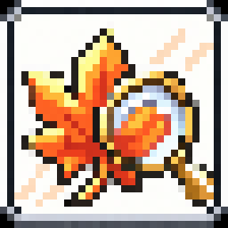

# Lupin

Market prices beside your **MapleStory Classic World** items.

Previously named Classic Price Lens. Updates keep your settings and saved history.

Open a player shop or hover over an inventory/equipment item to see its name and a market-price reference. Prices include cash/NX items and are shown in **mesos**. Equipment is treated as unscrolled.

Track EXP gained, your pace over 1–60 minutes, and estimated time to level. Save training sessions to compare maps, with optional notes about gear or your party. Open **Session options** to add context and **History** to compare saved runs. History stays on your device and can be exported to CSV.

The app reads shared screen pixels and draws separate, click-through labels. It never hooks into the game. Screenshots stay on your device.

## Download and install

Get the latest files from **[itch.io](https://zhuffman68.itch.io/classic-price-lens)**. Repository collaborators can also use [GitHub Releases](https://github.com/zhuffman68/classic-price-lens/releases).

| System | Choose | Install |
| --- | --- | --- |
| Windows 10/11 x64 | `Windows-x64-Setup.exe` | Run it, then open Lupin from Start. |
| Arch / Manjaro | `.pkg.tar.zst` | `sudo pacman -U ./lupin-0.6.0-1-x86_64.pkg.tar.zst` |
| Debian 12+ / Ubuntu 22.04+ | `.deb` | `sudo apt install ./lupin_0.6.0-1_amd64.deb` |

You'll need a supported 64-bit desktop, about **1 GB free space**, and internet for price updates. Python, Qt and the reader are included. Linux screen sharing needs PipeWire and a working desktop sharing portal; KDE and GNOME normally provide them.

A portable Windows ZIP is also available: extract it fully and open `run-windows.bat`.

## Get started

1. Open Lupin and choose the display containing the game.
2. Click **Start reading** and approve screen sharing if prompted.
3. Keep the bottom status bar visible. The app finds the game area automatically and follows it when it moves. Moving or closing the minimap is fine.
4. Open a shop or hover an item. Minimize the panel when you're ready.

**Preview with examples** explains the prices without sharing a screen.

Use the **Search** tab to look up an item by name, including NX items. Select a result to check its meso price. Search works without screen sharing and shares the same saved price cache as the overlay.

For EXP, open **EXP → Start session**, train, then **Finish & save**. Keep the bottom status bar visible; an open minimap title supplies the map name, or you can enter a label. A confirmed map or character change saves the current test. **Pause session** pauses the test while item pricing continues. The EXP card appears above the game's status bar; turn it off in Settings if preferred.

The pace is a projection from the observed portion of the selected window; the measured gain and duration are shown underneath. Rates need 30 seconds to settle. Paused or missing stretches are excluded; standing still counts. Percentage progress carries across level-ups, and inferred cross-level EXP totals are marked approximate.

## Everyday controls

- Shop and inventory labels show item names, market references, price ages and availability.
- **Pause / Resume:** hides or restores labels. Resume reuses the sharing session.
- **Minimize:** puts the panel in the system tray by default and sends a notification. Click the tray icon to restore it. Right-click for reading controls, labels, Settings and Quit. If no tray is available, the panel minimizes to the taskbar.
- **Close or Quit:** ends reading and screen sharing.
- **Settings:** change the hotkey, hover prices, price update interval, automatic area detection or tray behavior.

Prices are cached for **15 minutes** by default. **Price checked** shows when the app last looked up a price; **latest market report** shows how old the source data is. Expand **Details** for the source and more information. References are a guide, not guaranteed sale prices. Few reports or old data receive no deal rating.

Visible prices can refresh shortly before expiry. During a refresh, the previous value stays visible with its age and progress; the hovered item takes priority over queued shop lookups.

## If something isn't working

- **Can't find the game:** uncover the bottom status bar and the game window. For a cropped, covered or unusual layout, use **Settings → Limit the reading area…** to select it yourself. Multiple visible game windows also need a manual area.
- **Sharing stopped or labels don't line up:** use **Reconnect display** and share the selected display or full workspace.
- **No market reports:** the item name was recognised, but the source has no price for it.
- **Need more help:** open **Settings → Connection details / capture preview…**.

Upgrades keep settings and cached prices. Windows installation is checked under Wine; live native Windows capture and mixed-DPI alignment still need a Windows playtest.

[Windows help](README-WINDOWS.md) · [Architecture](ARCHITECTURE.md) · [Technical details and source builds](docs/TECHNICAL.md) · [Building installers](packaging/README.md) · [Validation](VERIFICATION.md) · [Credits and licenses](THIRD_PARTY.md)
